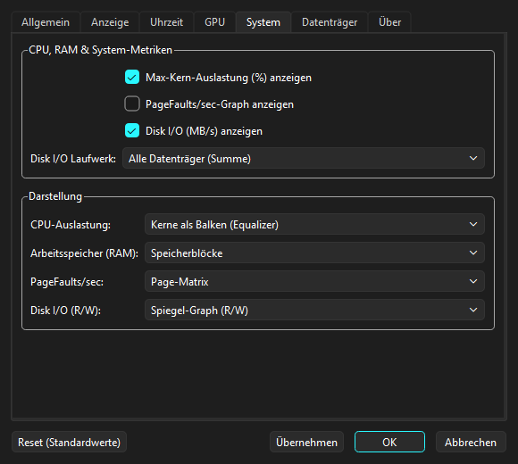

# SystemBox

> Schlankes, plattformübergreifendes Live-Desktop-Widget-System (Windows 10/11 & Linux / KDE Plasma) zur Echtzeit-Überwachung von Uhrzeit/Datum, GPU-, CPU/System- und Datenträger-Metriken – optisch und architektonisch angelehnt an [TrafficBox](https://github.com/WhiteSephi/traffic-box).

<p align="center">
  
  <br>
  <em>Live-Desktop-Widgets: Uhrzeit & Datum, GPU-Telemetry (NVIDIA/AMD/Intel), System-Metriken & Datenträger</em>
</p>

<p align="center">
  
  <br>
  <em>Modulare Darstellungsmodi: CPU-Equalizer, Heatmap, RAM-Speicherblöcke, Page-Matrix & Dual/Spiegel-Graph</em>
</p>

<p align="center">
  
  <br>
  <em>Umfangreicher Einstellungs-Dialog mit Visualizer-Auswahl, Themes, Skalierung & Sensor-Steuerung</em>
</p>

---

## 💻 Systemanforderungen

- **Betriebssystem:**
  - **Windows:** Windows 10 / 11 (64-Bit)
  - **Linux:** Aktuelle Distribution mit KDE Plasma / X11 oder Wayland (mit System-Tray)
- **Windows (Standalone-Binary):** Keine Python-Installation erforderlich (~23 MB `SystemBox.exe`, ca. 50–90 MB RAM im Betrieb)
- **Aus dem Quellcode (Linux & Windows):** Python **3.11+** (getestet mit Python 3.12), **PySide6 ≥ 6.6.0**, `psutil ≥ 5.9.0` und `nvidia-ml-py ≥ 12.535.0`
- **GPU (optional):** NVIDIA über NVML; AMD/Intel über Linux `sysfs`/`hwmon`/`drm` bzw. Windows-Performance-Counter
- **Berechtigungen:** Keine Administrator- oder Root-Rechte erforderlich

---

## 🚀 Installation & Schnellstart

### Windows (Empfohlen – ohne Python)

1. Lade die aktuelle **`SystemBox.exe`** von den [GitHub Releases](https://github.com/WhiteSephi/system-box/releases/latest) herunter.
2. Lege die Datei in einen beliebigen Ordner (z. B. `C:\Tools\SystemBox\`) und starte sie per Doppelklick.

> **Hinweis zu Windows SmartScreen:** Da `SystemBox.exe` ein unsigniertes Open-Source-Binary ist, zeigt Windows beim allerersten Start eventuell eine SmartScreen-Meldung (*„Der PC wurde geschützt“*). Klicke auf **Weitere Informationen → Trotzdem ausführen**.
> Optional kannst du die Integrität vorab gegen die `SHA256SUMS.txt` aus dem Release prüfen:
> ```powershell
> Get-FileHash .\SystemBox.exe -Algorithm SHA256
> ```

---

### Linux / CachyOS / Arch Linux (KDE Plasma)

```bash
git clone https://github.com/WhiteSephi/system-box.git
cd system-box

python -m venv .venv
source .venv/bin/activate
pip install -r requirements.txt

# Widget-Suite starten:
chmod +x start_linux.sh
./start_linux.sh
```

*(Die `start_linux.sh` bevorzugt unter KDE Plasma automatisch XCB/XWayland, sodass Positionierung und automatische Taskleisten-Ausblendung zuverlässig greifen.)*

---

<details>
<summary><strong>Windows aus dem Quellcode starten (für Entwickler)</strong></summary>

```powershell
git clone https://github.com/WhiteSephi/system-box.git
cd system-box
python -m venv .venv
.\.venv\Scripts\Activate.ps1
pip install -r requirements.txt

# Start ohne Konsolenfenster (oder im Terminal via: python -m src.main):
wscript.exe .\start_windows.vbs
```

Optionales `.env`-Setup für Umgebungsvariablen:
```bash
cp .env.example .env
```

</details>

---

## ⚙️ Konfiguration & Bedienung

- **Standard-Speicherort der Einstellungen (`config.json`):**
  - **Windows:** `%APPDATA%\systembox\config.json`
  - **Linux:** `~/.config/systembox/config.json`
- **Portabler Modus (z. B. USB-Stick):** Liegt im Programmverzeichnis der Ordner `local/` und enthält eine `config.json`, speichert SystemBox alle Einstellungen und Logs direkt dort, ohne das Benutzerprofil zu verändern.
- **Bedienung der Widgets:**
  - **Linke Maustaste ziehen:** Jedes Widget frei auf dem Desktop platzieren (mit magnetischem Einrasten an Bildschirmrändern und anderen Widgets, sofern nicht gesperrt).
  - **Doppelklick / Rechtsklick / Tray-Icon / Zahnrad-Button:** Öffnet direkt den passenden Reiter in den **Einstellungen** (Uhrzeit, GPU, System, Datenträger, Themes, UI-Skalierung `70–300 %`, Autostart).
  - **Doppelklick auf ein Laufwerk im Datenträger-Widget:** Öffnet das entsprechende Laufwerk direkt im System-Dateimanager.

---

## 🔒 Datenschutz & Sicherheit

- **100 % lokal & keine Telemetrie:** SystemBox erfasst alle Hardware-, Uhrzeit- und Speicherdaten ausschließlich lokal auf deinem Rechner. Es gibt keinerlei automatische Updates-Checks, Telemetrie oder Hintergrundverbindungen ins Internet.
- **Externe Links nur auf manuellen Klick:** Ausgehende Links werden ausschließlich nach ausdrücklichem Klick im *Über*-Tab geöffnet (`GitHub`, `Releases`, `Fehler melden`).
- **Datensparsames Logging & Fehlerberichte:** Das optionale Debug-Logging (`logs/systembox.log`, max. `3 × 1 MB`) sowie der Fehlerbericht-Assistent unter `Einstellungen → Über → Fehler melden` maskieren automatisch Benutzerpfade (`~`), private/nicht-standardmäßige IPv4-Adressen (`<IP>`) und Parameter wie Passwörter/Tokens (`***`) und zeigen dir den vollständigen Text vor dem Öffnen als Vorschau.
- **Gehärtete Persistenz & Multi-Instance-Schutz:** Konfigurationsdateien werden strikt typgeprüft (`AppConfig`), gegen QSS-Injection abgesichert und atomar geschrieben; unter Linux/KDE Plasma wird `~/.config/kwinrulesrc` über einen `flock`-Lock synchronisiert.

---

## 🧪 Automatisierte Tests & Build

Das Projekt verfügt über eine isolierte `pytest`-Testsuite, die das echte Benutzerprofil (`%APPDATA%` / `~/.config`) und den Autostart nicht berührt:

```bash
# Alle Tests ausführen (optional mit QT_QPA_PLATFORM=offscreen)
pytest -v
```

Eigenen Windows-Standalone-Build erstellen:
```powershell
pip install pyinstaller
pyinstaller --clean --noconfirm SystemBox.spec
```

---

## 📂 Projektstruktur

```text
.
├── .github/workflows/          # GitHub Actions (CI-Tests & Windows-Release-Build)
├── assets/                     # App-Icon (app_icon.ico) & Vorschau-Screenshots
├── src/
│   ├── main.py                 # Einstiegspunkt, CLI-Flags (--autostart, --debug) & Logging
│   ├── app.py                  # Widget-Manager, Polling-Timer & System-Tray
│   ├── config.py               # Zentrale Konfiguration, Validierung & atomares Speichern
│   ├── logger.py               # Rotating-File-Logging mit Privacy-Redaction & Diagnose
│   ├── autostart.py            # Cross-Platform Autostart (Windows Registry, XDG, KWin)
│   ├── themes.py               # Kuratierte Farb-Themes
│   ├── sensors/                # Plattformübergreifendes Sensor-Provider-Pattern
│   │   ├── models.py           # Datenmodelle (GpuSample, CpuSystemSample, DiskSpaceInfo)
│   │   ├── base.py             # Abstrakte Sensor-Schnittstellen
│   │   ├── manager.py          # Hardware-Erkennung & Polling-Koordination
│   │   ├── nvidia_provider.py  # NVIDIA-Telemetry via NVML (nvidia-ml-py)
│   │   ├── linux_hwmon.py      # Linux AMD/Intel GPU via sysfs/hwmon/drm
│   │   ├── windows_fallback.py # Windows PDH-, NtQuery- & HWiNFO-Fallbacks
│   │   ├── psutil_provider.py  # CPU-, RAM-, Disk-I/O- & Uptime-Provider
│   │   └── disk_space.py       # Laufwerks- & Btrfs-Subvolume-Erkennung
│   └── ui/
│       ├── base_widget.py      # Rahmenloses Widget, Edge-Snapping, Grip & Kontextmenü
│       ├── clock_widget.py     # Uhrzeit-, Datums- & Uptime-Widget
│       ├── gpu_widget.py       # GPU-Telemetry-Widget
│       ├── cpu_widget.py       # System-Widget (CPU, RAM, PageFaults, Disk I/O)
│       ├── storage_widget.py   # Datenträger-Speicherplatz-Widget
│       ├── graph_canvas.py     # Live-Verlaufsgraph (Einzel- & Kombi-Graph)
│       ├── visualizers/        # Modulare Visualizer (Equalizer, Heatmap, Blocks, Matrix, R/W)
│       ├── settings_dlg.py     # Einstellungs-Dialog (7 Tabs inkl. Diagnose & Über)
│       ├── color_picker.py     # Moderner Color-Picker mit Palette & Hex-Eingabe
│       ├── icons.py            # Vektor-UI-Icons
│       ├── linux_x11.py        # EWMH-Taskleisten-Ausblendung über libX11
│       └── tray.py             # Dynamisches App- & System-Tray-Icon
├── tests/                      # Isolierte Unit- & UI-Tests (pytest + conftest.py)
│   ├── conftest.py             # Globale Test-Isolation (Config, Logs, Autostart)
│   ├── test_autostart.py       # Autostart-Befehle, KWin-Sync & Path-Escaping
│   ├── test_config.py          # Config-Roundtrip, Clamping & Security-Härtung
│   ├── test_logger.py          # Privacy-Redaction, Diagnose-Bericht & Issue-URL
│   ├── test_sensors.py         # Multi-GPU-Auswahl, sysfs/hwmon & Fehlerresilienz
│   ├── test_settings_and_app.py# SettingsDialog, Tabs, Kontextmenü, Tray & Disk-I/O
│   ├── test_storage.py         # Btrfs-Deduplizierung, Laufwerksfilter & StorageWidget
│   ├── test_visualizers.py     # Alle Visualizer-Modi, Grid-Skalierung & Settings
│   └── test_widgets.py         # Skalierung, Edge-Snapping, Warn-Badges & X11-Hooks
├── SystemBox.spec              # PyInstaller-Build-Konfiguration für Standalone-Binaries
├── start_windows.vbs           # Starter ohne Konsolenfenster für Windows (Source-Modus)
├── start_linux.sh              # Starter-Skript für Linux / KDE Plasma (XCB/Wayland)
├── requirements.txt            # Python-Abhängigkeiten
├── pyproject.toml              # Pytest-Konfiguration
├── .env.example                # Vorlage für Umgebungsvariablen
├── LICENSE                     # MIT-Lizenz
└── CHANGELOG.md                # Chronologische Änderungshistorie
```

---

## 📄 Lizenz & rechtlicher Hinweis

- **Lizenz:** Dieses Projekt steht unter der [MIT-Lizenz](LICENSE).
- **Markenhinweis:** SystemBox ist ein unabhängiges Open-Source-Projekt. Alle genannten Produktnamen und Marken (z. B. *Windows*, *KDE Plasma*, *NVIDIA*, *AMD*, *Intel*) sind Eigentum ihrer jeweiligen Rechteinhaber.

---

## 🤖 KI-Hinweis / AI Disclosure

> Dieses Projekt wurde mit KI-Unterstützung entwickelt. Feedback und Verbesserungsvorschläge sind willkommen!  
> *Developed with AI assistance. Feedback and contributions are welcome.*
