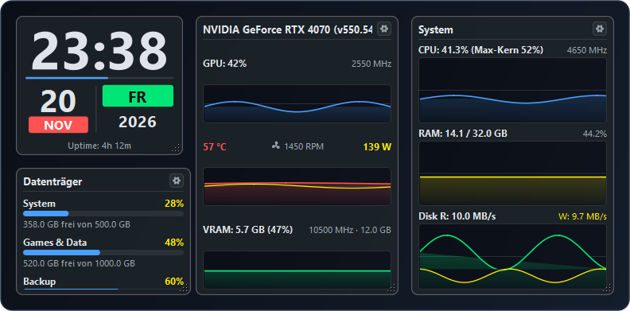
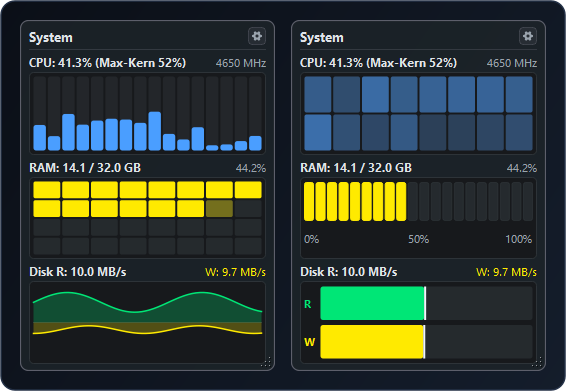

# SystemBox

> Schlankes, plattformübergreifendes Live-Desktop-Widget-System (Windows 11 & Linux / KDE Plasma) zur Echtzeit-Überwachung von Uhrzeit/Datum, GPU- und CPU/System-Metriken – optisch und architektonisch angelehnt an [TrafficBox](https://github.com/WhiteSephi/traffic-box).

<p align="center">
  
  <br>
  <em>Live-Desktop-Widgets: Uhrzeit & Datum, GPU-Telemetry (NVIDIA/AMD/Intel), System-Metriken & Datenträger</em>
</p>

<p align="center">
  
  <br>
  <em>Modulare Darstellungsmodi: CPU-Equalizer, Heatmap, RAM-Speicherblöcke, Page-Matrix & Dual/Spiegel-Graph</em>
</p>

<p align="center">
  
  <br>
  <em>Umfangreicher Einstellungs-Dialog mit Visualizer-Auswahl, Themes, Skalierung & Sensor-Steuerung</em>
</p>

---

## 🛠️ Tech-Stack & Voraussetzungen

- **Sprache / Runtime:** Python 3.11+
- **GUI-Framework:** PySide6 (Qt6) mit stufenloser HiDPI-/Vektor-Skalierung
- **Sensorik:** `psutil` (Basis-Metriken), `nvidia-ml-py` (`pynvml` für NVIDIA GPUs), native `sysfs`/`hwmon`-Unterstützung unter Linux sowie DXGI/Performance-Counter-Fallbacks unter Windows (ohne Admin-Rechte)

---

## 📋 Systemanforderungen

| Bereich | Mindestanforderung / Empfehlung |
| :--- | :--- |
| **Betriebssystem** | Windows 10 / 11 (64-Bit) oder Linux (x86_64, KDE Plasma / X11 oder Wayland mit System-Tray) |
| **Prozessor (CPU)** | x86_64 Dual-Core (sehr geringe Dauerlast bei Standard-Intervall `1000 ms`) |
| **Arbeitsspeicher (RAM)** | ca. 50–90 MB im Betrieb (Qt6 + 3 Live-Widgets; mind. 128 MB frei empfohlen) |
| **Speicherplatz** | ca. 23 MB für die Standalone-`.exe` + `< 1 MB` für die lokale Konfiguration |
| **GPU (optional)** | NVIDIA mit aktuellem Treiber (NVML); AMD/Intel via Windows-Fallback bzw. Linux `hwmon` |
| **Berechtigungen** | Keine Administrator- oder Root-Rechte erforderlich |

---

## 🚀 Installation & Setup

1. **Repository klonen:**
   ```bash
   git clone https://github.com/WhiteSephi/system-box.git
   cd system-box
   ```

2. **Umgebung & Abhängigkeiten einrichten:**
   ```bash
   python -m venv .venv
   # Windows:
   .venv\Scripts\activate
   # Linux:
   source .venv/bin/activate

   pip install -r requirements.txt
   ```

3. **Konfiguration (optional):**
   ```bash
   cp .env.example .env
   ```

---

## 💻 Verwendung / Starten

```bash
# Direkt über Python starten:
python -m src.main

# Oder über die Startskripte:
# Windows: start_windows.vbs
# Linux:   ./start_linux.sh
```

---

## 📂 Projektstruktur

```text
.
├── src/
│   ├── config.py        # Zentrale Konfiguration & Theme-Presets
│   ├── sensors/         # Plattformübergreifendes Sensor-Provider-Pattern
│   ├── ui/              # Basis-Widget, Clock/GPU/CPU-Widgets, Tray & Settings
│   └── main.py          # Einstiegspunkt & Widget-Manager
├── tests/               # Unit-Tests (Sensoren, Config, UI-Komponenten)
├── start_linux.sh       # Linux-Startskript (XCB/Wayland)
├── start_windows.vbs    # Fensterloses Windows-Startskript
├── SystemBox.spec       # PyInstaller Build-Konfiguration (.exe)
└── CHANGELOG.md         # Chronologische Änderungshistorie
```

---

## 🤖 KI-Hinweis / AI Disclosure

> Dieses Projekt wurde mit KI-Unterstützung (Google Antigravity) entwickelt. Feedback und Verbesserungsvorschläge sind willkommen!  
> *Developed with AI assistance. Feedback and contributions are welcome.*
